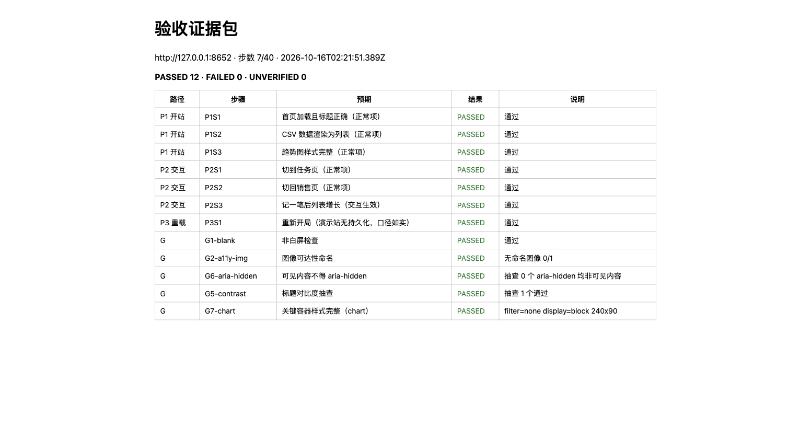
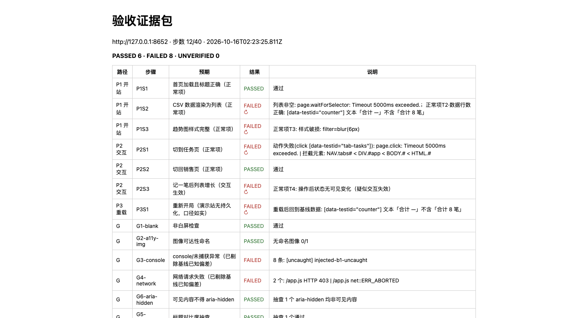

# acceptance-evidence-kit (English)

**Reproducible acceptance evidence for small static web projects.** Each check runs as a written step and ends in one of three states — **PASSED / FAILED / UNVERIFIED** — with a screenshot, and every candidate failure is replayed once independently before it is called a failure.

It is **not** an "AI auto-QA" product and does **not** claim "no bugs". It only proves: *these steps really ran, and here is what happened.* Anything not tested is listed as "not tested".



> The screenshot is an archived report from 2026-10-16. Re-cloning the public repo and re-running (2026-10-23, 2026-10-24) gives the same result: 12 PASSED / 0 FAILED / 0 UNVERIFIED.

中文版（首屏更完整）见 [README.md](README.md)。

## Who it is for

- Freelancers and small studios delivering static sites, who want more than "I tested it".
- Clients who want a re-checkable record instead of an oral assurance.
- Anyone who needs "acceptance criteria" turned into an executable checklist.

Fits: statically hosted small web projects (company sites, small tools, demo pages).
Does not fit: anything behind a login, payments, server-side writes, complex business systems.

## Input / output

**Input**: one publicly reachable URL + a `manifest.json` (about 3 critical paths, each written as goto / click / hover / wait plus assertions).
**Output**: `report.html` / `report.md` with per-step PASSED / FAILED / UNVERIFIED, a screenshot for every failed step (passed steps get one when relevant), failures replayed once independently before they are called failures, and an explicit "not tested" statement.

## Quick start (about 5 minutes)

```bash
npm ci                # or: npm i playwright   (package-lock.json pins playwright 1.64.1)
npx playwright install chromium

node proxy.mjs &      # serves sample-site/ on 127.0.0.1:8652 only
node run.mjs --manifest manifest.json --out out/clean
open out/clean/report.html   # 12 PASSED / 0 FAILED
```

- Node.js >= 18 required. Playwright is an external dependency (Apache-2.0), not vendored here.
- The first run downloads Chromium (a hundred-odd MB); on a slow link that step takes extra time. In China you can point `PLAYWRIGHT_DOWNLOAD_HOST` at a mirror, e.g. `export PLAYWRIGHT_DOWNLOAD_HOST=https://cdn.npmmirror.com/binaries/playwright`.
- Windows: replace `open` with `start out\clean\report.html`, and run `node proxy.mjs` in a second terminal instead of `&`.
- Of the "12 PASSED", 3 are **generic spot checks** (image alt text / aria-hidden / heading contrast) that sampled only 0–1 elements here: PASSED means "the sampled elements were fine", not "coverage is good".

## Run it on your own site

Copy `manifest.json`, change `base_url` and the paths, and you are testing your own site.

```json
{
  "base_url": "https://your-site.example",
  "limits": { "nav_timeout_ms": 15000, "step_timeout_ms": 5000, "max_total_steps": 40, "reverify": 1 },
  "abort_steps": [],
  "generic": { "root_selector": "#app", "contrast_selectors": "h1,h2,h3", "style_checks": [] },
  "known_deviations": { "url_substrings": [] },
  "unverified_note": "Say which scenarios this chain cannot reach, so nobody reads it as full coverage.",
  "paths": [
    { "id": "P1 landing", "steps": [
      { "id": "P1S1", "action": "goto", "expect": "hero title renders",
        "assert": [ { "kind": "text", "selector": "h1", "contains": "Your title", "note": "title is correct" } ] }
    ] }
  ]
}
```

- **Actions**: `goto` / `reload` / `click` / `hover` / `wait` (ms) / `skip` (declared as not executed → recorded UNVERIFIED).
- **Assertions**: `visible` / `not_visible` / `count0` / `text` (substring) / `style` (`filter_none`, `min_size`) / `state_change` (`min_changed`).
- **Generic spot checks** (`generic`): blank page, image alt naming, visible content hidden with `aria-hidden`, heading contrast, key container styles (declare selectors in `style_checks`).
- **Known baseline deviations** (`known_deviations.url_substrings`): register your own pre-existing problems (e.g. an image that always 404s). They stop counting against the gate, but the report still lists them — nothing is hidden.
- **Limits**: `base_url` currently lives in the manifest only (no command-line override); public pages and client-side interaction only — no login, payments or server writes; only the paths you write are covered.

## See it catch real defects

```bash
Ctrl+C            # stop the proxy from the previous step (bash: kill %1 works too)
node proxy.mjs --injections faults-demo.json --only I1 &
node run.mjs --manifest manifest.json --out out/fault-I1
open out/fault-I1/report.html     # P2S1 FAILED + blocking-element diagnosis
```

The public `faults-demo.json` contains 6 common defect injections, each with a pre-registered signature:

| id | injection | signature when injected alone (in the full set they mask each other, see below) |
|---|---|---|
| W1 | key JS asset returns 403 | data-list step FAILED + network failure list |
| B1 | uncaught exception | G3-console FAILED (pageerror channel) |
| D1 | corrupted CSV row | summary-text assertion FAILED (8 items → 7) |
| S1 | chart blur style regression | style FAILED + G7-chart FAILED |
| A1 | main list hidden with aria-hidden | G6-aria-hidden FAILED |
| I1 | button with pointer-events disabled | action failure + blocking-element diagnosis |

```bash
# Everything at once: injections can mask each other, which is why failures are reported as they are
node proxy.mjs --injections faults-demo.json --only W1,B1,D1,S1,A1,I1 &
```



## What it does not do

- It only covers the paths written in `manifest.json` (plus a fixed set of generic health checks: blank page / console / network / accessibility / contrast); everything else is untested, and untested is stated as such.
- It is not a security scan, not a performance test, and does not mean "no bugs".
- No login, no payments, no server-side writes: public pages and client-side interaction only.
- Cost: MIT, free; about 3–5 minutes per run; no hosted service, no account system.
- v0.1 experiment version: interfaces and report format may still change.

## Feedback

If you ran it (or tried to), please open an issue: <https://github.com/Wynnhao/acceptance-evidence-kit/issues>
The most useful feedback is: **which step confused you**, **which assertion you don't trust**, **which failure sample did not actually reproduce**. If you got stuck installing or writing a manifest, post that too. That is worth more than a star.

## Repository layout

```
proxy.mjs            restricted static server + defect injection (127.0.0.1 only)
run.mjs              runner: manifest → report
manifest.json        3 demo paths (replace with your own)
faults-demo.json     6 public defect injections
sample-site/         synthetic demo site (fully fictional data)
docs/sample-reports/ success and failure sample reports
```

## License

MIT © 2026 Wynn. See [LICENSE](LICENSE).
